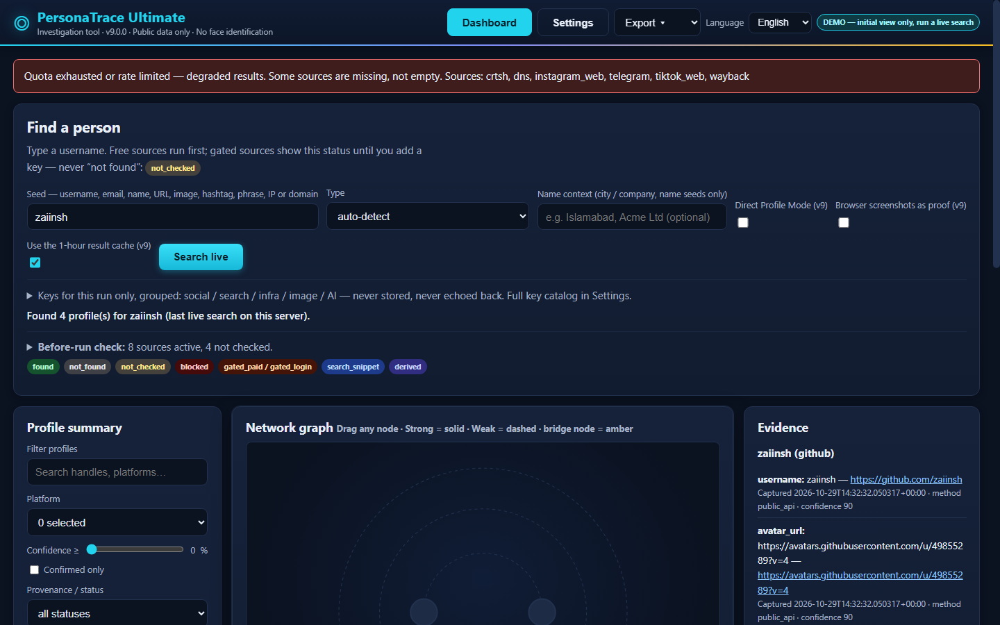

# PersonaTrace Ultimate — v9.0.0

<p align="center">
  
</p>

<p align="center">
  <strong>Local-First · Explainable Identity Resolution · Ethical OSINT Profiling · 100% Verifiable Provenance</strong>
</p>

<p align="center">
  
  
  
  
  
</p>

---

## 🎯 Overview

**PersonaTrace Ultimate** is a living cross-platform Open Source Intelligence (OSINT) profiler and identity investigation platform. Unlike standard search scrapers that simply dump lists of unverified links, PersonaTrace constructs a **centre-node identity graph** with **explainable confidence scores**, tracks profile mutations across time, and compiles complete single-case investigative dossiers with source URLs, UTC timestamps, and cryptographic provenance for every asserted fact.

Runs entirely on your local machine using Python standard library components and SQLite. No mandatory cloud servers, zero external telemetry.

---

## ✨ Key Features

- **🌐 10+ Multi-Seed Types**:
  - `username`: Cross-platform discovery across GitHub, Mastodon, Bluesky, Dev.to, Reddit archives, Gravatar, and Sherlock/WhatsMyName site lists.
  - `email`: Gravatar hashing, public linked accounts, domain extraction, and passive infrastructure scans.
  - `domain` / `ip`: DNS records, WHOIS, ASN, crt.sh certificate transparency, and Shodan InternetDB.
  - `name`: Candidate search across engines with human-in-the-loop review queues.
  - `url` / `profile`: Direct Profile Mode anchoring an exact public profile and expanding outward.
  - `image`: Perceptual hashing (pHash) for same-photo reuse clustering.
  - `wallet`, `hashtag`, `phrase`, and multi-seed queries.

- **⚖️ 3-Tier Explainable Confidence & Entity Resolution**:
  - $\ge 80$: High-confidence match (auto-merge, logged, reversible).
  - $50 - 79$: Possible-match review queue (requires human investigator sign-off).
  - $< 50$: Separated (low confidence, rejected).
  - Stylometry and posting routine can never exceed 25% of the total merge score to prevent false-positive confirmation bias.

- **🖥️ Forensic Local Web Dashboard**:
  - Dynamic 3-ring center-node SVG identity graph with draggable nodes and bridge-node highlighting.
  - Live timeline replay slider visualizing profile and evidence evolution over time.
  - Two-signal site verification (HTTP status + body fingerprinting).
  - Single-click case report drafting with human sign-off verification.

- **📁 Multi-Format Case Dossier Export**:
  - Export cases into **HTML**, **JSON**, **Markdown**, **CSV**, and **PDF** formats.

---

## 🛡️ Strict Ethical Guardrails

1. **Public Data Only**: No access to private accounts, DMs, or real-time location tracking.
2. **No Face Identification**: Image forensics are strictly limited to perceptual same-image reuse (pHash). No biometric facial recognition exists in the codebase.
3. **No Platform Protection Bypasses**: Never bypasses CAPTCHAs, paywalls, or login walls. Unchecked platforms report status `not_checked` rather than brittle bypasses.
4. **Mandatory Provenance**: Every piece of data records capture timestamp (UTC), source URL, method, and score.

---

## 🚀 Quick Start

### 1. Requirements
- **Python 3.11+**
- Optional: `pip install Pillow reportlab` (for PDF reports and advanced image proof cards)

### 2. Launch the Web Interface
```bash
python run_personatrace.py
```
*Starts the local web server on port 8790 and automatically opens `http://127.0.0.1:8790/` in your default browser.*

Or start the server directly:
```bash
python -m personatrace.gui.server --port 8787
```

### 3. Run via Terminal (CLI)
```bash
# Run a live case on a username seed:
python -m personatrace.cli --seed octocat --out live_out

# Run an email seed:
python -m personatrace.cli --seed target@example.com --seed-type email --out email_case

# Run an exact URL seed:
python -m personatrace.cli --seed https://github.com/octocat --seed-type url --out url_case
```

---

## 🧪 Testing

PersonaTrace includes a comprehensive automated test suite (236 tests):

```bash
pip install pytest
pytest tests/ -q
```

---

## 📂 Project Structure

```
personatrace-app/
├── personatrace/
│   ├── core/         # Seed ingestion, username variation generator, entity resolution
│   ├── adapters/     # Live source adapters (GitHub, Bluesky, Mastodon, Wayback, etc.)
│   ├── features/     # pHash image reuse, bio-link expansion, timeline, NLP heuristics
│   ├── gui/          # Local HTTP server, dashboard HTML/CSS/JS assets
│   ├── storage/      # SQLite schema, case storage, graph models
│   └── ai/           # Pluggable deterministic & LLM report drafting
├── demo/             # Labelled fictional test cases
├── docs/             # Documentation and dashboard screenshots
├── packaging/        # PyInstaller build specs for Linux, Windows, and macOS
├── tests/            # Full pytest test suite (236 tests)
├── run_personatrace.py # One-click launcher script
└── requirements.txt  # Dependencies (pytest, optional imaging libraries)
```

---

## 📄 License

This project is licensed under the **MIT License**. See the [LICENSE](LICENSE) file for details.
